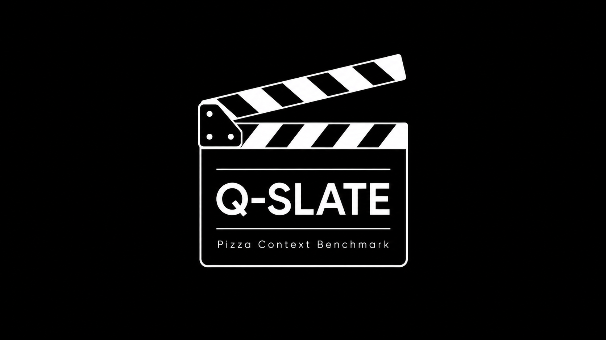

# Pizza Context Benchmark

Good Pizza, Great Pizza의 손님 주문을 이용해 여러 LLM의 주문 이해·추론 능력을 비교하는 프로젝트입니다.

## 현재 실행 가능한 평가

**영어 100문항**을 제공합니다. 모델은 지시문 없이 주문, 주방 상태, 메뉴와 도구 명세만 받고, 좌표 기반 모의 주방에서 피자를 만들어 제출합니다. 정해진 추가 설명을 한 번 요청할 수 있으며, 문항 사이에는 이전 대화를 전달하지 않습니다. RAG와 검색은 사용하지 않습니다.

문항별 결과는 최종 피자가 정답 A를 만족하는지의 통과, 실패입니다. NLU, Reasoning, Planning 단계별 평가 연결은 후속 작업입니다. L과 A는 초안이며, 팀원 검수를 거쳐 정답으로 확정합니다.

## 시작하기

Python 3.10 이상과 Tkinter가 필요하며 추가 Python 패키지는 필요하지 않습니다.

```powershell
python -m pizzabench.game
python scripts/run_benchmark.py --provider anthropic --estimate-cost
```

첫 명령은 사람이 직접 만들거나 모델을 실행하는 게임 화면을, 둘째 명령은 100문항 일괄 실행의 비용 추정을 엽니다. 키는 Git에서 제외된 `configs/api_keys.local.json`에 넣습니다. 빈 형식은 [키 설정 예시](configs/api_keys.example.json)에 있습니다.

모델별 실행과 공정한 결과 비교, API 설정과 오류 정책은 [모델 실행](docs/model_runs.md)에 정리합니다.

## 폴더 안내

| 폴더 | 역할 |
| --- | --- |
| `data/` | [영어 100문항, 메뉴, 이전 형식 샘플 안내](data/README.md) |
| `configs/` | 서비스별 모델, 가격과 키 설정 형식 |
| `scripts/` | 일괄 실행, 결과 비교, L 작성 도구 빌드 명령 |
| `pizzabench/` | 모의 주방, 채점, 모델 실행기 구현 |
| `tools/` | L 주문서 작성 도구 원본 |
| `tests/` | 주방, 채점, 입력 분리, 실행, 화면 테스트 |
| `schemas/` | 기존 Q-SLATE 형식의 구성 요소·전체 문항 예시 |
| `docs/` | 실행 계약·평가 설계·데이터 구조·제작 규칙 |
| `assets/` | 문서용 이미지 |

모델 실행 결과는 `results/` 아래에 생성됩니다.

## 상세 문서

| 문서 | 기준으로 삼을 내용 |
| --- | --- |
| [인수인계](docs/project_status.md) | 현재 상태와 다음 작업 |
| [모델 실행](docs/model_runs.md) | 모델 실행, 비용 추정, 결과 비교 |
| [평가 설계](docs/benchmark_rules.md) | 전체 Task·E2E와 병목 분석의 장기 설계 |
| [데이터 구조](docs/schema_rules.md) | 영어 100문항과 기존 Q-SLATE 필드 |
| [L 주문서 형식](docs/linguistics_form.md) | L의 형식, 작성 규칙, 작성 도구 |
| [피자 제작 조건](docs/pizza_domain_rules.md) | 도메인 조건·기본값·영역·수량의 의미 |
| [모의 게임](docs/mock_game.md) | 제작 환경의 도구·재고·실행 규칙 |

## Q-SLATE 설계



Q는 주문, S는 환경 상태, L은 문장 의미 분석, A는 제작 요구조건, T는 행동 계획, E는 실행 기록입니다. 전체 설계는 NLU·Reasoning·Planning·Tool Use/Computer Use·E2E를 구분합니다. 전체 JSON 예시와 단계별 계약은 위 상세 문서에서 관리합니다.

기존 웹 수집 자료는 [영어 주문 목록](https://good-pizza-great-pizza.fandom.com/wiki/List_of_orders)과 [한국어 레시피](https://namu.wiki/w/%EC%A2%8B%EC%9D%80%20%ED%94%BC%EC%9E%90%2C%20%EC%9C%84%EB%8C%80%ED%95%9C%20%ED%94%BC%EC%9E%90/%EB%A0%88%EC%8B%9C%ED%94%BC)를 바탕으로 합니다.

## 검증

```powershell
python -m unittest discover -s tests
```

## English

The benchmark has 100 English orders. A model receives only the order, the kitchen state, the menu and the tool specification, with no instructions, and makes the pizzas in a coordinate-based mock kitchen. Each case passes when the served pizzas satisfy the reference answer. Stage-wise NLU, Reasoning and Planning evaluation is still to be connected.

See the [model runs](docs/model_runs.md), [evaluation design](docs/benchmark_rules.md), and [data formats](docs/schema_rules.md). The L and A references are drafts until the team's review is complete.
